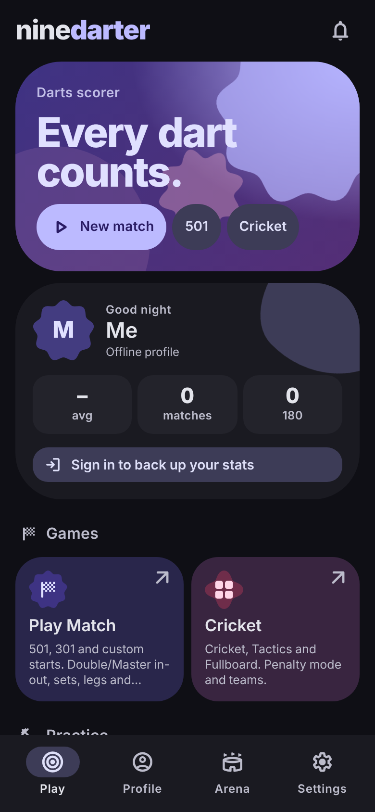
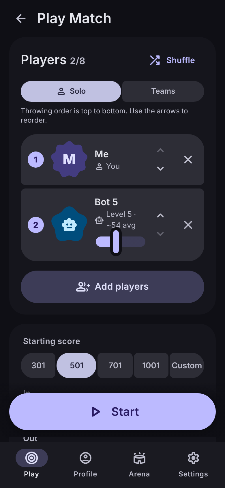
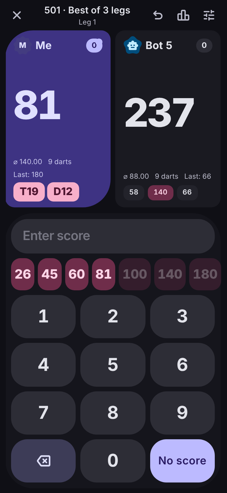

  

<h1 align="center">🎯 ninedarter</h1>

  <b>The darts scorer that feels like a modern app.</b> 
  X01 · Cricket · Training games · Bots · Deep stats · Friends — right in your browser.

  

  
  
  
  

  <a href="#english">English</a> · <a href="#türkçe">Türkçe</a>

  
  
  

---

## 🇬🇧 English

### What is it?
**ninedarter** keeps score for your darts nights so you can just throw. Enter a visit total or tap dart by dart; busts, checkouts and impossible scores are handled for you, and every match turns into stats you can actually learn from. Play against friends, an 11-level bot, or train alone.

### 🎯 Games
- **X01** — 301 / 501 / 701 / 1001 or custom · straight, double or master in & out · first-to or best-of · legs and sets · up to 8 players or teams
- **Cricket** — Cricket, Tactics, Fullboard and Akyaka (sequential) · penalty, master, classic points or no-score · teams and round limits
- **Training** — 121 Checkout, Around the Clock, Bob's 27, Doubles Training, Random Checkout, Shanghai

### ✨ Highlights
| | |
|---|---|
| ⌨️ **Fast input** | Quick-score keypad (26, 45, 60, 81, 100, 140, 180) or dart-by-dart, keyboard support, unlimited undo. |
| 🤖 **Bots** | 11 levels, from ~25 to ~107 average, throwing on real board geometry and following checkout routes. |
| 📊 **Stats** | 3-dart average, first 9, checkout %, best leg, high finish, ton counts, cricket MPR, records and trend charts. |
| 👥 **Friends** | Account, profile photo, cloud sync, friends, shared match history, messages and notifications. |
| 🗣️ **Caller** | Checkout hints and a voice that calls your scores — *“One hundred and eighty!”* |
| 🎨 **Design** | Material 3 Expressive: dynamic colour, expressive shapes, spring motion, light & dark themes. |
| 📴 **Offline** | Install it as an app; it works without internet and without an account. |

### ▶️ Open the app
**https://tunagirit.github.io/ninedarter/**

---

## 🇹🇷 Türkçe

### Nedir?
**ninedarter**, dart akşamlarında skoru senin yerine tutar, sen sadece at. Toplam skoru gir ya da dart dart dokun; bust, checkout ve imkânsız skorlar otomatik algılanır, her maç gerçekten işine yarayan istatistiklere dönüşür. Arkadaşlarınla, 11 seviyeli botla oyna ya da tek başına antrenman yap.

### 🎯 Oyunlar
- **X01** — 301 / 501 / 701 / 1001 veya özel · straight, double, master giriş ve çıkış · "ilk N" ya da "en iyi N" · leg ve set · 8 oyuncuya kadar ya da takım
- **Cricket** — Cricket, Tactics, Fullboard ve Akyaka (sıralı) · ceza, master, klasik puan ya da cezasız · takım ve tur sınırı
- **Antrenman** — 121 Checkout, Saat Yönünde, Bob's 27, Doubles Training, Rastgele Checkout, Shanghai

### ✨ Öne çıkanlar
| | |
|---|---|
| ⌨️ **Hızlı giriş** | Hızlı skor tuşları (26, 45, 60, 81, 100, 140, 180) ya da dart dart giriş, klavye desteği, sınırsız geri al. |
| 🤖 **Botlar** | 11 seviye, ~25'ten ~107 ortalamaya; gerçek tahta geometrisinde atar, checkout rotalarını izler. |
| 📊 **İstatistik** | 3 dart ortalaması, ilk 9, checkout %, en iyi leg, en yüksek bitiriş, 100+/140+/180, Cricket MPR, rekorlar ve gelişim grafikleri. |
| 👥 **Arkadaşlar** | Hesap, profil fotoğrafı, bulut senkronizasyonu, arkadaşlar, ortak maç geçmişi, mesajlar ve bildirimler. |
| 🗣️ **Sesli anons** | Checkout önerileri ve skoru okuyan ses — *“One hundred and eighty!”* |
| 🎨 **Tasarım** | Material 3 Expressive: dinamik renk, ifadeli şekiller, yaylı hareketler, açık ve koyu tema. |
| 📴 **İnternetsiz** | Uygulama olarak yükle; internet ve hesap olmadan da çalışır. |

### ▶️ Uygulamayı aç
**https://tunagirit.github.io/ninedarter/**

---

  © 2026 tunagirit · <b>All rights reserved / Tüm hakları saklıdır.</b> 
  The source is public for viewing only — see <a href="LICENSE">LICENSE</a>. · Kaynak kodu yalnızca incelenmek için açıktır — <a href="LICENSE">LICENSE</a>.

